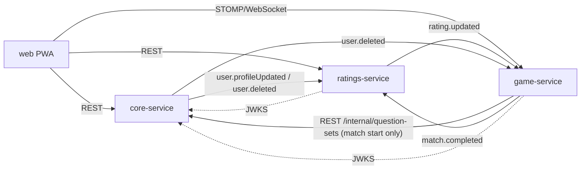
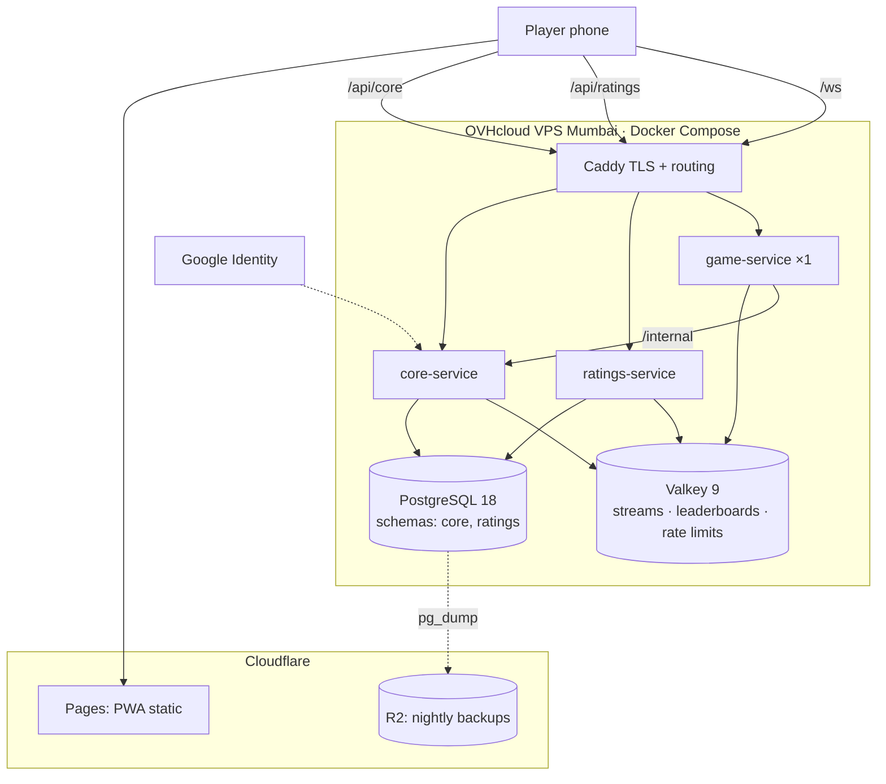
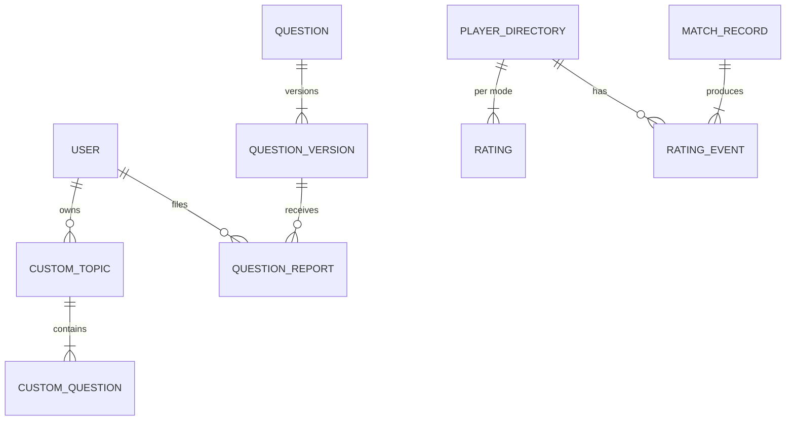

# Architecture Spine — Minnal (quiz-arena) MVP

## Design Paradigm

**Three coarse-grained, event-driven microservices** behind one reverse proxy, plus a static React PWA. Inside `game-service`, the **actor model**: every live match, Battle Room, and matchmaking queue is one in-memory actor that processes its events strictly one at a time. Each service is internally **package-by-feature**, layered `api → application → domain → infrastructure`.

| Service | Owns (sole writer) | Interface |
| --- | --- | --- |
| `core-service` | users, profiles, roles, refresh tokens, questions (+versions), question reports, custom topics, solo practice | REST `/api/core/v1/**`, internal `/internal/**`, JWKS; publishes `user.*` |
| `game-service` | matchmaking queues, live matches, Battle Rooms, bots, room codes, rating cache (read model) | STOMP over WebSocket `/ws`; publishes `match.completed` |
| `ratings-service` | ratings (3 tracks), rating events, match history, leaderboards, player directory (read model) | REST `/api/ratings/v1/**`; publishes `rating.updated` |
| `web` (PWA) | nothing server-side; renders server state | — |

## Invariants & Rules



Solid REST edges are synchronous; event edges are Valkey Streams (`minnal.*`).

### AD-1 — Service boundaries and single owners [ADOPTED]

- **Binds:** all
- **Prevents:** two services writing the same entity; features landing in whichever service is convenient.
- **Rule:** Each entity has exactly one owning service per the Paradigm table; only that service writes it. Other services hold only event-fed read models, never write back. A new capability goes in the service owning its core entity; a 4th service requires a new AD.

### AD-2 — Dependency direction [ADOPTED]

- **Binds:** all
- **Prevents:** call cycles and runtime coupling between services.
- **Rule:** Only the edges in the diagram above exist. The single synchronous service-to-service call is `game → core /internal/question-sets`, made only when a match or room match starts — never during play. All other cross-service data moves as events. `core-service` calls no other service.

### AD-3 — Data ownership: schema per service [ADOPTED]

- **Binds:** core-service, game-service, ratings-service
- **Prevents:** cross-service joins that make services inseparable.
- **Rule:** One PostgreSQL instance, one schema and one DB login per service (`core`, `ratings`; `game` has none at MVP). A login has grants only on its own schema. Cross-service references are by `userId`/`matchId`/`questionId` UUID only — no cross-schema foreign keys or reads. Schema changes are Flyway migrations inside the owning service. Valkey keys are prefixed by owner (`core:`, `game:`, `ratings:`); only streams use the shared `minnal.` prefix.

### AD-4 — Actor discipline in game-service [ADOPTED]

- **Binds:** FR-4, FR-5, FR-6, FR-9; game-service
- **Prevents:** races between timer expiry, answers, joins, and disconnects; DB latency in the answer path (<200 ms).
- **Rule:** Every live match, room, and matchmaking queue is one actor with its own inbound event queue. All state changes — answers, timer ticks, joins, cancels, disconnects, bot answers, rematch requests — are events on that queue, processed sequentially by the actor's single thread; no other thread reads or mutates actor state. No DB or network I/O happens between a match's first question and its final reveal; outbound effects during play are WebSocket sends only. In-flight state is lost on crash/redeploy (accepted).

### AD-5 — Answer secrecy [ADOPTED; amended 2026-11-12, sprint-change-proposal-2026-11-12]

- **Binds:** FR-3.4, FR-4.6, FR-7.4, NFR-security
- **Prevents:** the correct answer — or a hint of correctness — reaching a player who could still use it: in Battle Room before the question closes; in every mode, anyone's pick or correctness reaching another participant before the question closes.
- **Rule:** The client-facing `QuestionView` has **no** answer or explanation field. A question is sent only when its window opens. `SCOREBOARD` shows who has answered, never what or whether correct. In Battle Room, `ANSWER_ACCEPTED` is receipt-only. In 1v1 modes (Quick Match, Topic Duel), `ANSWER_ACCEPTED` is private to the answering player and also carries her own `correct`, `points` and the question's `answerIndex` — she can no longer change her answer, and her only rival is the opponent. When the question closes, one `QUESTION_REVEALED` carries answer index, explanation, attribution, every pick and updated scores. Full sets with answers exist only on `/internal/question-sets` and in actor memory. Solo Practice (core-service, REST) returns correctness + explanation only in the response to that question's submission.

### AD-6 — Server clock and scoring [ADOPTED]

- **Binds:** FR-4.5, FR-5.6, FR-6.8, NFR-security
- **Prevents:** client-forged timings; modes scoring differently.
- **Rule:** The actor sets one `startedAt` instant per question when it broadcasts `QUESTION_STARTED`; response time = server receive instant − `startedAt`. Client timestamps are ignored. Window = 15 s; later answers are rejected. First answer per participant per question wins; later ones are dropped. A question closes when its window ends or, earlier, as soon as every participant still in the match (not forfeited; bots included) has answered — the actor then reveals at once (amended 2026-11-12). After each reveal the actor holds 2 s (3 s in Battle Room), then starts the next question. Scores always use each answer's own receive time, so closing early never changes points. Score = correct ? `500 + round(500 × remainingMs / 15000)` : `0`, computed by the single `Scoring` function in `contracts/`, used by every mode and by bots.

### AD-7 — Bots are ordinary participants [ADOPTED]

- **Binds:** FR-4.2–4.4, FR-5.4
- **Prevents:** bot-specific branches in match, scoring, or results code.
- **Rule:** A bot is a `Participant` of kind `BOT` that submits answers through the same actor events as humans, with randomized per-question delay. Only `kind` distinguishes it (drives the bot badge). Bots never join Battle Rooms; bots auto-accept rematch.

### AD-8 — Match completion, ranking, and `match.completed` [ADOPTED]

- **Binds:** FR-2.3, FR-4.8, FR-5.5, FR-6.9, FR-9, FR-10, FR-1.5
- **Prevents:** game-service computing ELO; quitting to erase a loss; ties or forfeits scored differently in results vs ratings; rating farming on private topics.
- **Rule:** A match is **completed** once Q1 has been revealed; it is **aborted** (nothing published) only if every human forfeits before that. On completion game-service publishes one `minnal.match.completed`: `{eventId, matchId, mode, roomId?, questionSource: BANK|CUSTOM, rated, startedAt, endedAt, queueWaitMs?, participants[{participantId, userId?, kind: USER|GUEST|BOT, displayName, score, correctCount, forfeited, placement}]}`. `placement` comes from the single `Ranking` function in `contracts/` (score desc, then correctCount desc, else tie). `rated = (questionSource == BANK)`. ratings-service is the sole computer of ELO (standard, K=32, start 1200, per mode): it rates only `USER` participants when `rated`, derives win/loss/draw only from `placement`, treats a `GUEST` opponent as rating 1200 and a `BOT` as the human's current rating, and still records history (with `ratingDelta = null`) when not rated. Forfeiters are rated on their earned placement. The results screen fetches deltas from `GET /api/ratings/v1/matches/{matchId}` (404 → retry for up to 10 s, then show "updating").

### AD-9 — Identity and tokens [ADOPTED]

- **Binds:** FR-1, all services
- **Prevents:** services implementing login checks or user identity differently.
- **Rule:** Google sign-in only at MVP. core-service verifies the Google ID token and issues a Minnal RS256 access JWT (1 h; claims `sub`, `roles` ⊂ {USER, ADMIN}, `name`, `lang`) plus a 30-day rotating refresh token in an httpOnly cookie. Guests get a 24 h JWT with role `GUEST` and random `sub`, never persisted; guest results are not migrated on registration (the web keeps the last guest result in `sessionStorage` for the FR-1.4 prompt). game-service and ratings-service validate JWTs against core's JWKS as resource servers. WebSocket clients send the JWT in STOMP `CONNECT`; game-service takes participant identity (`sub`, `name`, `lang`) only from that token; an open session is not cut on expiry, but every reconnect needs a valid token. Mode access (guest = Quick Match only) is enforced in game-service. Admins are bootstrapped from the `ADMIN_EMAILS` env var. Login sits behind an interface in core-service so phone OTP can be added later.

### AD-10 — Real-time protocol [ADOPTED]

- **Binds:** game-service, web
- **Prevents:** each mode inventing its own messages; ordering gaps on reconnect.
- **Rule:** STOMP over WebSocket, Spring simple broker. Broadcasts: `/topic/match/{matchId}`, `/topic/room/{roomId}`. Private: `/user/queue/game`. Client sends: `/app/matchmaking/{mode}/join|cancel`, `/app/match/{matchId}/answer|rematch|resync|leave` (`leave` forfeits immediately, with no 10 s grace), `/app/room/create`, `/app/room/join`, `/app/room/{roomId}/configure|start|leave|playAgain`. Server envelope: `{type, matchId|roomId, seq?, refSeq?, serverTime, payload}`. `seq` numbers **broadcasts only**, +1 per topic; private messages carry `refSeq` (the last broadcast `seq` they reflect). Every participant in a payload appears as `{participantId, displayName, kind}`. `QuestionView` carries both `textMl` and `textEn` (when available); the client picks by profile language. Types are SCREAMING_SNAKE: `MATCH_FOUND`, `MATCHMAKING_FAILED`, `QUESTION_STARTED`, `ANSWER_ACCEPTED`, `SCOREBOARD`, `QUESTION_REVEALED`, `MATCH_ENDED`, `SNAPSHOT`, `REMATCH_*`, `ROOM_*` (incl. `ROOM_JOINED`, `ROOM_LOBBY_UPDATED`, `ROOM_CLOSED`, `ROOM_START_FAILED`, `ROOM_MATCH_STARTED`, `ROOM_SUCCEEDED`), `ERROR` (codes incl. `SERVER_DRAINING` while game-service drains). Answers may carry an optional client field `prevAckRttMs` — telemetry only, never used for timing or scoring.

### AD-11 — Sessions, reconnect, and forfeit [ADOPTED]

- **Binds:** NFR-reliability, FR-4, FR-5, FR-6
- **Prevents:** inconsistent disconnect handling; duplicate participation; stale state after reconnect.
- **Rule:** A participant is keyed by JWT `sub` and may hold several sessions; it is `DISCONNECTED` only when its last session closes. A `sub` may be in at most one queue, room, or match at a time (else `ERROR ALREADY_IN_MATCH`). A disconnect is an actor event with a 10 s grace; reconnecting within it yields a private `SNAPSHOT {refSeq, phase, questionIndex, question?, deadline?, lastReveal?, scores, participants}`. The client buffers broadcasts until `SNAPSHOT`, drops any with `seq ≤ refSeq`, and on a `seq` gap sends `resync`. After 10 s the participant is `forfeited`, scores 0 on remaining questions, and the match continues.

### AD-12 — Question data and the question-set contract [ADOPTED]

- **Binds:** FR-3, FR-4.9, FR-5.3, FR-6.4, FR-8, FR-11
- **Prevents:** game-service reading question tables; private topics leaking; results and reports referring to a question that has since changed.
- **Rule:** Bank questions move `DRAFT → PUBLISHED` or `DRAFT → DISCARDED`; a published question is immutable — an edit creates a new `version` (new DRAFT), deletion is soft. Only `PUBLISHED` versions are served. One validator in core-service checks the admin form, CSV upload, and custom-topic JSON (FR-3.3 / FR-8.3 shape). `POST /internal/question-sets {source: BANK|CUSTOM, filters: {category, subjectId?, topicId?, examLevel?}, customTopicId?, count, requesterId}` returns exactly `count` questions `{questionId, version, textMl?, textEn?, options, answerIndex, explanation, attribution?}` or `422` if not enough exist (never a short set). `CUSTOM` succeeds only when `requesterId` owns the topic. Reveal and `MATCH_ENDED` messages carry `questionId`, `version`, and attribution; reports reference `{questionId, version}`; custom-topic questions are not reportable. `/internal/**` is reachable only on the private Docker network (never routed by Caddy) and requires the internal service token.

### AD-13 — Matchmaking [ADOPTED]

- **Binds:** FR-4.1, FR-4.2, FR-5.2–5.4
- **Prevents:** queue races between cancel, pairing, and bot fill; trusting client ratings.
- **Rule:** One matchmaking actor per `(mode, topicId?)`, handling `JOIN | CANCEL | DISCONNECT | TICK`. Ratings come only from game-service's in-memory cache fed by `minnal.rating.updated` (replayed on boot; missing → 1200); client-supplied ratings are never read. Pair within ±200, widening to ±400 at 4 s; at 8 s pair with a bot. Guests may pair with users. After pairing, the actor fetches the question set (2 s timeout) **before** sending `MATCH_FOUND`; failure → `MATCHMAKING_FAILED` and both players are returned to idle. `CANCEL` after pairing is rejected. Queue wait time is recorded in `queueWaitMs`.

### AD-14 — Battle Rooms, rematch, and play again [ADOPTED]

- **Binds:** FR-6, FR-9.3
- **Prevents:** room codes colliding; room id confused with match id; post-match flows with no owner.
- **Rule:** A room is a game-service actor (`LOBBY → IN_MATCH → ENDED`). Code = 6 chars from `SecureRandom` over an alphabet excluding `0 O 1 I L`, displayed as `XXX-XXX`, unique among live rooms. Cap 50 players; start requires ≥ 2 humans; only the host configures (source, count 5–30, default 10) and starts; the host leaving the lobby closes the room. Starting mints a fresh `matchId` (`ROOM_MATCH_STARTED`), and play then uses the standard match destinations. A room expires at match end or 24 h, whichever comes first; rooms are lost on restart. After `MATCH_ENDED`, the match actor stays in `POST_MATCH` for 60 s, accepting only `REMATCH_REQUEST` (1v1: both humans must request; bots auto-accept → new match, same mode/topic, same participants) or host `PLAY_AGAIN` (new room with the same source; broadcasts `ROOM_SUCCEEDED {code}` to all players).

### AD-15 — Event delivery on Valkey Streams [ADOPTED]

- **Binds:** all event edges in AD-2
- **Prevents:** lost or double-applied rating changes; consumers diverging on delivery semantics.
- **Rule:** Valkey runs with AOF `appendfsync everysec`. Each consumer uses a named consumer group, one consumer per service, and acknowledges (`XACK`) only after its DB transaction commits; pending entries are reclaimed on boot. Delivery is at-least-once: every handler is idempotent by `eventId` (ratings also by `matchId`). An event failing 5 times moves to `minnal.deadletter`. Streams are capped with `MAXLEN ~100000`. Every payload carries `eventId` and an occurred-at `Instant`. Publishers write events to a transactional outbox table (`event_outbox`, in the publishing service's own schema) in the same DB transaction as the state change; a relay then `XADD`s them. game-service (no schema) publishes directly with retry.

### AD-16 — Read models for names, ratings, and deletion [ADOPTED]

- **Binds:** FR-2, FR-10, FR-4.1
- **Prevents:** three services showing different display names; deleted users lingering on boards.
- **Rule:** core-service publishes `minnal.user.profileUpdated {eventId, userId, displayName, district, examLevel, language, updatedAt}` and `minnal.user.deleted {eventId, userId}`. ratings-service keeps a `player_directory` (last-write-wins by `updatedAt`), and every leaderboard and history response embeds `displayName` from it. On `user.deleted`, ratings removes the user from every leaderboard and tombstones the name, and game-service rejects that `sub`. ratings-service publishes `minnal.rating.updated {eventId, userId, mode, rating, ratedAt}` after each rating change.

### AD-17 — Leaderboards are a projection [ADOPTED]

- **Binds:** FR-10.3, FR-10.4
- **Prevents:** Valkey becoming a second source of truth; inconsistent period boundaries.
- **Rule:** Postgres `ratings` schema (ratings + rating events) is authoritative. Valkey sorted sets `ratings:lb:{mode}:{daily|weekly|alltime}:{periodKey}` are written only by ratings-service and must be rebuildable from Postgres. A match counts in the period containing its `endedAt`, evaluated in `Asia/Kolkata`; weeks start Monday. Daily/weekly rank = sum of rating deltas in the period; all-time = current rating.

### AD-18 — Frontend renders server state only [ADOPTED]

- **Binds:** web
- **Prevents:** client-side scoring, timing, or answer checks; a heavy bundle on 3G / 2 GB phones.
- **Rule:** The live-game store (Zustand) is updated only by the single WebSocket connection module; components never compute scores or correctness. The countdown derives from the server deadline plus the clock offset from `serverTime`. REST data goes through TanStack Query. The last `MATCH_ENDED` payload is kept in `sessionStorage` so results survive a reload. Budget: initial JS ≤ 150 KB gzipped, admin UI lazily loaded at `/admin`, Malayalam font self-hosted as a subset `woff2`. The service worker caches the app shell only and never `/api/**` or `/ws`. The manifest meets Android Chrome installability.

### AD-19 — Deployment and operations envelope [ADOPTED]

- **Binds:** all; NFR-performance, NFR-reliability
- **Prevents:** infrastructure sprawl beyond a ~₹450/month budget; memory exhaustion; unsafe deploys.
- **Rule:** Production = one OVHcloud VPS (Mumbai, 2 vCPU / 4 GB) running Docker Compose: `caddy`, `core-service`, `game-service` (exactly 1 replica), `ratings-service`, `postgres`, `valkey`. Every container has a memory limit; each JVM's heap is capped (≈384 MB) so the total stays under 3.2 GB. Every container has a healthcheck and `restart: unless-stopped`; an external uptime ping watches `/health`. On shutdown, game-service stops accepting new matches and rooms and waits up to 5 min for live ones. The PWA is static on Cloudflare Pages; the API allows CORS only from that origin. A nightly `pg_dump` goes to Cloudflare R2, with a monthly restore drill. Environments: local (same Compose file) and prod. Metrics go to the Grafana Cloud free tier. CI/CD runs on GitHub Actions: build, test, push the images, deploy to the VPS, and publish the Pages site. Secrets — including the internal service token, rotated by redeploy — live in a server-side `.env`, never in git.

## Consistency Conventions

| Concern | Convention |
| --- | --- |
| Repo | Monorepo: `services/{core,game,ratings}`, `contracts/`, `web/`, `deploy/` |
| Shared code | Only `contracts/` is shared: event records, `/internal` DTOs, STOMP envelope and message types, `Scoring`, `Ranking`. No shared domain or persistence code |
| Java packages | `in.minnal.<service>.<feature>.(api / application / domain / infrastructure)` |
| IDs | UUID, generated by the owning service |
| Time | `Instant` / ISO-8601 UTC on the wire and in the DB; IST only for display and leaderboard periods |
| REST errors | RFC 9457 Problem Details (Spring `ProblemDetail`) |
| REST paths | `/api/<service>/v1/...` via Caddy; JSON camelCase |
| Events | Stream names `minnal.<aggregate>.<pastTenseVerb>`; payload carries `eventId`, aggregate id, occurred-at |
| Logging & metrics | JSON logs with `requestId` (Caddy `X-Request-Id`) and `matchId`/`userId` when known. Micrometer metrics from day 1, including the PRD counter-metrics: matchmaking wait time, bot-fill rate, completed vs aborted matches |
| Rate limits | Per-user token buckets in Valkey for REST writes (reports, custom-topic import, admin upload); per-connection inbound message limit in game-service |
| Config | Spring profiles `local`, `prod`; all secrets via env vars |
| i18n | UI strings via react-i18next (`ml`, `en`); question language from profile, fallback to the other language |
| Custom topics | Caps 50 topics / 500 questions per user, warning at ≥ 80%, enforced in core-service |

## Stack

| Name | Version |
| --- | --- |
| Java | 25 (LTS) |
| Spring Boot | 4.1.x (4.1.1 at authoring) |
| Spring Security, WebSocket/STOMP, Flyway | via Spring Boot 4.1 BOM |
| PostgreSQL | 18 |
| Valkey | 9.0 |
| Maven (multi-module) | 3.9.x |
| React | 19.3 |
| TypeScript | 6.0 |
| Vite | 8.1 |
| vite-plugin-pwa | 1.x |
| TanStack Query | 5.x |
| Zustand | 5.0 |
| Tailwind CSS | 4.3 |
| react-i18next | 17.x |
| @stomp/stompjs | 7.3 |
| Caddy | 2.11 |
| Docker Compose | v2 |
| Hosting | OVHcloud VPS Mumbai 2 vCPU/4 GB; Cloudflare Pages; Cloudflare R2 |

## Structural Seed



```mermaid
sequenceDiagram
  participant P as Players
  participant G as game-service actors
  participant C as core-service
  participant V as Valkey Streams
  participant R as ratings-service
  P->>G: /app/matchmaking/{mode}/join
  G->>C: POST /internal/question-sets
  G->>P: MATCH_FOUND
  loop each question
    G->>P: QUESTION_STARTED (no answer)
    P->>G: answer
    G->>P: ANSWER_ACCEPTED (1v1: own result; rooms: receipt only)
    G->>P: QUESTION_REVEALED + scores (all answered, or 15 s)
  end
  G->>P: MATCH_ENDED (breakdown, placements)
  G->>V: minnal.match.completed
  V->>R: consume, idempotent
  R->>V: minnal.rating.updated
  V->>G: refresh rating cache
  P->>R: GET /api/ratings/v1/matches/{matchId}
```



```text
quiz-arena/
  contracts/          # events, /internal DTOs, STOMP envelope + types, Scoring, Ranking
  services/core/      # identity, profile, questions, custom topics, solo practice, admin
  services/game/      # matchmaking, match + room actors, bots, rating cache, STOMP endpoints
  services/ratings/   # ELO, rating events, match history, leaderboards, player directory
  web/                # React PWA (player app + lazy /admin)
  deploy/             # compose.yaml, Caddyfile, backup + restore scripts
```

## Capability → Architecture Map

| Capability / Area | Lives in | Governed by |
| --- | --- | --- |
| FR-1 Auth (Google + guest, register prompt) | core-service, web | AD-9 |
| FR-2 Profile, ratings display, history | core-service (fields), ratings-service (ratings, history) | AD-1, AD-8, AD-16 |
| FR-3 Question bank, reports, attribution | core-service | AD-5, AD-12 |
| FR-4 Quick Match | game-service | AD-4–AD-8, AD-10, AD-11, AD-13 |
| FR-5 Topic Duel | game-service | AD-4–AD-8, AD-12, AD-13 |
| FR-6 Battle Room | game-service | AD-4–AD-6, AD-8, AD-14 |
| FR-7 Solo Practice | core-service | AD-5 |
| FR-8 Custom Topics | core-service | AD-12, conventions |
| FR-9 Match results, rematch, play again | game-service (breakdown), ratings-service (deltas) | AD-8, AD-10, AD-14, AD-18 |
| FR-10 Ratings & leaderboards | ratings-service | AD-8, AD-15–AD-17 |
| FR-11 Admin | core-service + web `/admin` | AD-9, AD-12 |
| NFR performance / security / reliability | all | AD-4–AD-6, AD-11, AD-15, AD-18, AD-19 |

## Open Questions

| Question | Blocking? |
| --- | --- |
| India DPDP Act obligations for account and data deletion beyond AD-16's `user.deleted` | Before public launch |
| How to measure the "≥ 5 coaching centers using Battle Room" goal — there is no center entity at MVP | Before launch analytics |
| OVHcloud India bandwidth cap (10 Mbps after monthly quota) and Mumbai availability — confirm on the order page | Before provisioning |

## Deferred

| Item | Why it can wait / revisit when |
| --- | --- |
| Phone OTP login (PRD FR-1.1 — required, budget-gated) | ~₹5/SMS; add behind AD-9's login interface when budget allows. Adding it needs no new AD: core-service gains a second login method issuing the same Minnal JWT |
| Horizontal scaling of game-service | One replica serves MVP load; revisit with sticky routing by `matchId` and Valkey-backed queues when one instance saturates |
| Mid-match persistence / crash recovery | Accepted loss (AD-4); revisit if crash rate hurts retention |
| Staging environment | Solo dev; add when a second contributor joins |
| N-player ELO internals | Inside ratings-service only; assumed pairwise vs every other human, K = 32/(N−1) |
| Phase 2 (district boards, coaching dashboard, analytics, weak-topic report) | New consumers of `minnal.match.completed`, or a new service via a new AD |
